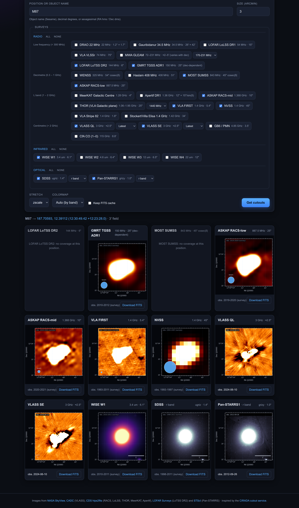

# Cutout Server

A multi-survey astronomical image cutout server, modelled on the
[CIRADA cutout service](http://cutouts.cirada.ca/). Enter an object name or sky
coordinates, pick surveys, and get rendered previews plus downloadable FITS —
across radio, infrared, and optical bands — with particularly broad radio
coverage (22 MHz to 115 GHz).

## Surveys

29 surveys across radio, infrared and optical. Radio is the deep
end: 23 surveys spanning 22 MHz to 115 GHz, sub-grouped by frequency band
in the picker (each group has **all** / **none** shortcuts).

| Survey | Band | Resolution | Coverage | Observed | Source | Per-survey choice |
|---|---|---|---|---|---|---|
| **Radio — Low frequency (< 300 MHz)** | | | | | | |
| DRAO 22 MHz | 22 MHz | 1.2° × 1.7° | All sky | 1965-1969 | SkyView | — |
| Gauribidanur 34.5 MHz | 34.5 MHz | 26′ × 42′ | Dec −50° to +70° | 1987 | SkyView | — |
| LOFAR LoLSS DR1 | 54 MHz | 15" | HETDEX field (650 deg²) | 2018-2021 | CDS hips2fits | — |
| VLA VLSSr | 74 MHz | 75" | Dec > −30° | ~2006 | SkyView | — |
| MWA GLEAM | 72–231 MHz | ≈2–5′ (varies with dec) | Dec < +30° | 2013-2014 | SkyView | band: 72-103 / 103-134 / 139-170 / **170-231** / *All* |
| LOFAR LoTSS DR2 | 144 MHz | 6" | 5 634 deg² (0h + 13h fields) | 2014-2020 | LOFAR Surveys | — |
| GMRT TGSS ADR1 | 150 MHz | 25" (dec-dependent) | Dec > −53° | 2010-2012 | SkyView | — |
| **Radio — Decimetre (0.3 – 1 GHz)** | | | | | | |
| WENSS | 325 MHz | 54" cosec(δ) | Dec > +30° | 1991-1996 | SkyView | — |
| Haslam 408 MHz | 408 MHz | 51′ | All sky | 1965-1979 | SkyView | — |
| MOST SUMSS | 843 MHz | 45" cosec\|δ\| | Dec < −30° | 1997-2007 | SkyView | — |
| ASKAP RACS-low | 887.5 MHz | 25" | Dec < +41° | 2019-2020 | CDS hips2fits | — |
| **Radio — L band (1 – 2 GHz)** | | | | | | |
| MeerKAT Galactic Centre | 1.28 GHz | 4" | Galactic Centre mosaic | 2018 | CDS hips2fits | — |
| Apertif DR1 | 1.36 GHz | 12" × 15"/sin(δ) | ≈1 000 deg² (northern fields) | 2019-2022 | CDS hips2fits | — |
| ASKAP RACS-mid | 1.368 GHz | 10" | Dec < +49° | 2020-2021 | CDS hips2fits | — |
| THOR (VLA Galactic plane) | 1.06–1.95 GHz | 25" | Galactic plane, ℓ = 15°–67° | 2012-2014 | CDS hips2fits | band: 1060 / 1310 / **1440** / 1690 / 1820 / 1950 / *All* |
| VLA FIRST | 1.4 GHz | 5.4" | ≈10 575 deg² (NGP + SGP caps) | 1993-2011 | SkyView | — |
| NVSS | 1.4 GHz | 45" | Dec > −40° | 1993-1997 | SkyView | — |
| VLA Stripe 82 | 1.4 GHz | 1.8" | 92 deg² of SDSS Stripe 82 | 2007-2009 | SkyView | — |
| Stockert/Villa Elisa 1.4 GHz | 1.42 GHz | 34′ | Dec > −16° | 1972-1974 | SkyView | — |
| **Radio — Centimetre (> 2 GHz)** | | | | | | |
| VLASS QL | 3 GHz | ≈2.5" | Dec > −40° | **2017-present** † | CADC (SODA) | epoch: *Latest* / 1 / 2 / 3 / 4 / *All* |
| VLASS SE | 3 GHz | ≈2.5" | Dec > −40° (epochs 1–3) | **2017-present** † | CADC (SODA) | epoch: *Latest* / 1 / 2 / 3 / 4 / *All* |
| GB6 / PMN | 4.85 GHz | 3.5′ | Dec −88° to +75° | **1986-1990** † | SkyView | — |
| CfA CO (1–0) | 115 GHz | 8.8′ | Galactic plane (9 853 deg²) | 1980-2000 | SkyView | — |
| **Infrared** | | | | | | |
| WISE W1 | 3.4 um | 6.1" | All sky | 2010-2011 | SkyView | — |
| WISE W2 | 4.6 um | 6.4" | All sky | 2010-2011 | SkyView | — |
| WISE W3 | 12 um | 6.5" | All sky | 2010-2011 | SkyView | — |
| WISE W4 | 22 um | 12" | All sky | 2010-2011 | SkyView | — |
| **Optical** | | | | | | |
| SDSS | ugriz | 1.4" | ≈14 500 deg² | 1998-2011 | SkyView | filter: u / g / **r** / i / z / *All* |
| Pan-STARRS1 | grizy | 1.0" | Dec > −30° | **2010-2014** † | STScI ps1images | filter: g / **r** / i / z / y / *All* |

† These surveys carry a real `DATE-OBS`/`MJD-OBS` in the FITS, so the preview shows the **exact date of that cutout** rather than the campaign span.

Surveys are grouped by wavelength (Radio → Infrared → Optical) and, within
radio, ordered by frequency. Radio cutouts carry the synthesised beam
(`BMAJ`/`BMIN`/`BPA`): SkyView strips these, so the documented beam is stamped
back in — including the declination-dependent beams of SUMSS, WENSS, TGSS and
Apertif, which are computed per position — while VLASS keeps its real elliptical
beam from the archive. New surveys are added in `cutout/providers.py`.

### Observation dates

Every preview is labelled in its top-left corner with when it was observed, and
the same value appears on the result card. There are two cases, deliberately
styled differently:

- **`obs. 2025-09-16`** — an exact date read from the cutout's own
  `DATE-OBS`/`MJD-OBS`. Available for VLASS (per-epoch, straight from the CADC
  archive), Pan-STARRS and GB6.
- **`obs. 1993-1997 (survey)`** — the survey's observing campaign, shown muted
  and tagged. SkyView strips the date during mosaicking exactly as it strips the
  beam, and hips2fits does not propagate one, so for most surveys no per-image
  date exists to show. The span comes from each survey's documentation.

The distinction matters: an NVSS pixel was observed *somewhere* in 1993–1997,
whereas a VLASS epoch-4 cutout was observed on one specific night.

### Image sources

| Backend | Used for | Notes |
|---|---|---|
| **SkyView** | the classic surveys | NASA's mosaicker; off-footprint positions 404 and are reported as "no coverage" |
| **CADC** | VLASS QL + SE | server-side SODA cutouts from the NRAO archive, native beam preserved |
| **CDS hips2fits** | RACS, LoLSS, THOR, MeerKAT, Apertif | reprojected from the survey's FITS HiPS — real pixel values, but resampled from the HiPS tiling rather than cut from the original mosaic. Used where the survey has no open cutout API (CASDA requires credentials for ASKAP) |
| **LOFAR Surveys** | LoTSS DR2 | cut straight from the DR2 mosaics |
| **STScI ps1images** | Pan-STARRS1 | two-step skycell lookup + `fitscut` |

Out-of-footprint positions are reported as *no coverage* rather than as an
error: hips2fits answers with an all-NaN image and the LOFAR server with an HTML
page, both of which are detected before caching.

## Run

```bash
# uses the existing `astro` env (astropy, astroquery, matplotlib, pillow, requests)
pip install -r requirements.txt
python app.py
# open http://127.0.0.1:5000
```

### FITS cache

Transient user cutouts are cached under `cache/`. By default a FITS file is
**removed once its PNG preview is generated** (the download then re-fetches it
on demand), so the cache stays small. To keep FITS on disk instead:

- tick **Keep FITS cache** in the UI (per search), or
- set the server default: `CUTOUT_KEEP_FITS=1 python app.py`.

In keep mode the FITS download is an instant copy of the cached file; in remove
mode it is re-fetched from the survey.

The bundled demo cutouts live in a separate **`demo_cache/`** that is looked up
first and **never** deleted, so the M87 example stays instant regardless of the
keep/remove setting.

## Input formats

- **Object name** (resolved via Sesame): `M87`, `3C 273`, `NGC 5128`
- **Decimal degrees**: `187.7059 12.3911` or `187.7059, 12.3911`
- **Sexagesimal**: `12:30:49.4 +12:23:28`

## Example: M87

Type **`M87`** (or any object name), leave the size at `3` arcmin, and hit
**Get cutouts**. You get one preview per selected survey, ordered by wavelength,
each with celestial axes, a synthesised-beam ellipse (radio) or angular scale
bar (infrared/optical), an observation-date label, and a FITS download link.
Surveys that do not reach the target say so instead of failing — at M87 that is
LoTSS and SUMSS, which cover other parts of the sky.



The colormaps run warm → cool with wavelength (radio `afmhot`, infrared `magma`,
optical `bone`) so the panels visually echo the spectrum. M87 (Virgo A) is a
good first target: its radio jet shows in FIRST/NVSS/VLASS, and the elliptical
galaxy in WISE, SDSS, and Pan-STARRS.

> The M87 cutout set is bundled in `demo_cache/`, so the example always loads
> instantly — these files are permanent and exempt from the cache cleanup
> above. Regenerate the cache with `PYTHONPATH=. python scripts/seed_demo.py`
> (it seeds every default survey that covers M87 and skips the rest) and the
> screenshot above with `PYTHONPATH=. python scripts/screenshot_ui.py`.
> Note `.gitignore` excludes `*.fits`, so `demo_cache/` is rebuilt locally
> rather than checked in.

## Layout

```
app.py                 Flask app + API endpoints
cutout/
  providers.py         survey registry + providers (SkyView / CADC VLASS / hips2fits / LoTSS / PanSTARRS)
  resolve.py           position / object-name resolution
  render.py            FITS -> PNG (WCS axes, beam/scale bar, obs date, stretches, colormaps)
  service.py           fetch + on-disk FITS cache (demo_cache + transient cache)
templates/index.html   dark-themed UI
static/                style.css, app.js
scripts/
  seed_demo.py         seed the bundled M87 demo cache (demo_cache/)
  screenshot_ui.py     capture the README UI screenshot (Selenium + Chrome)
screenshots/           README UI screenshot
demo_cache/            permanent bundled M87 cutouts (exempt from cleanup)
cache/                 transient user cutouts (removed in 'remove' mode)
```

## API

- `GET /api/cutout?position=&size=&surveys=&sel_<key>=&keep=` — resolve +
  per-survey availability and preview/FITS URLs. `sel_<key>` picks a survey's
  epoch/filter/band (or `all` to fan out); `keep=0|1` controls FITS retention.
  Each result carries `available`, `variant` (the chosen epoch/filter),
  `obs_date` and `obs_exact` (`true` = read from the FITS, `false` = the
  survey's campaign span), plus `preview_url` / `fits_url`.
- `GET /api/preview.png?survey=&ra=&dec=&size=&sel=&stretch=&cmap=&invert=&keep=` — PNG preview
- `GET /api/fits?survey=&ra=&dec=&size=&sel=&keep=` — FITS download
- `GET /api/surveys` — survey list: `key`, `name`, `group`, `subgroup`,
  `wavelength`, `resolution`, `coverage`, `obs_period`, `default`, `select`
  and the group's default `cmap`

## Notes

This code was generated by [Claude](https://www.anthropic.com/claude). It works
end to end, but bugs may remain — if you run into any errors or unexpected
behaviour, please reach out so they can be fixed.
